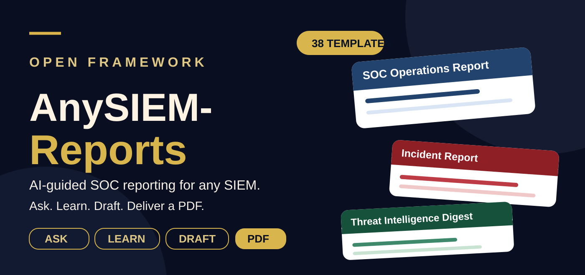
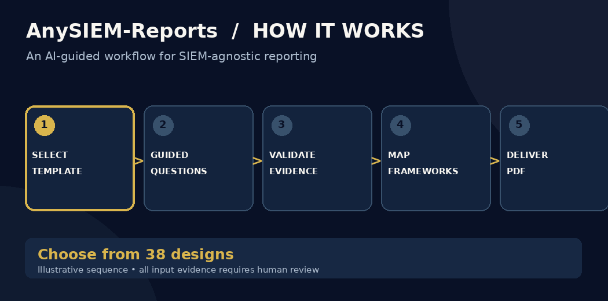
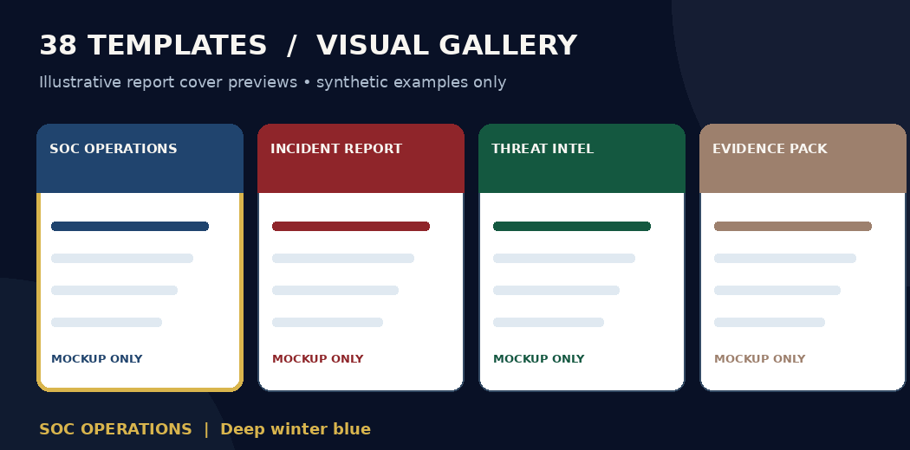
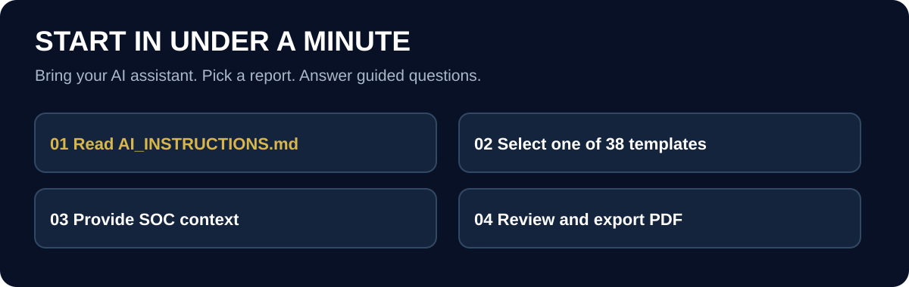
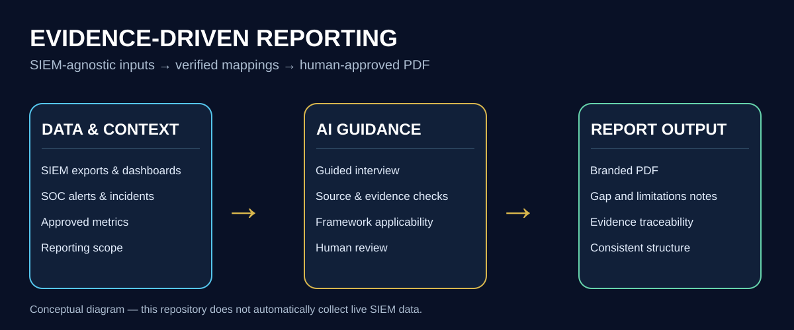

<div align="center">
 

### 38 professional report blueprints · Any SIEM · One polished PDF

[](catalog/templates.yaml) [](core/pdf-output-rules.md) [](AI_INSTRUCTIONS.md)

[**Quick Start**](#-quick-start) · [**Animated Workflow**](#-animated-workflow) · [**38 Templates**](#available-templates-38) · [**Contribute**](docs/ADDING_A_TEMPLATE.md)
</div>

> [!IMPORTANT]
> This is an **AI-assisted reporting framework**, not a hosted SaaS product or an automatically connected live SIEM. The AI helps structure evidence and prepare reports; all inputs and regulatory claims require review and approval.

## 🎞️ Animated workflow

<div align="center">


*Illustrative walkthrough; does not depict a live application.*



*Visual previews contain synthetic illustrations, not actual SOC results.*
</div>

## 🚀 Quick start



**Use an AI assistant with GitHub access:**

```text
Read AI_INSTRUCTIONS.md in the repository
https://github.com/amitambekar510/AnySIEM-Reports
and follow it exactly. Start by showing me the template catalog.
```

**No GitHub connection?** Download the repository ZIP, attach it to your assistant, and use the same prompt. Prepare a report period, SIEM version, approved metrics/evidence, regulatory scope, and SLA definitions. You can request **template mode** with placeholders or **populated mode** using authorized SOC data. [Complete usage guide](docs/HOW_TO_USE_WITH_AI.md).

## 🧭 From evidence to report



The repository is deliberately **SIEM-agnostic**. The AI asks about your environment and available evidence before drafting. It must not invent metrics, claim unverified compliance, or expose confidential customer data.

| ⚡ Guided | 🛡️ Evidence-first | 🎨 Report-specific design |
|:---|:---|:---|
| Bite-sized interview questions | Reviewable metrics and gaps | A distinct palette for each report |

**For contributors and practitioners:** see the [template catalog](catalog/templates.yaml), [framework coverage](docs/FRAMEWORK_COVERAGE.md), and [AI guardrails](AI_INSTRUCTIONS.md). All 38 report templates remain unchanged.

---

> An open framework that helps SOC teams build compliance-focused reporting templates for any SIEM. Connect it to your AI assistant, answer guided questions about your SOC, and generate a branded PDF report, whether monthly, quarterly, or annual.

**Author:** Amit Ambekar | [github.com/amitambekar510](https://github.com/amitambekar510)

---

## Why this exists

Every SOC eventually has to produce the same documents: periodic operations reports, incident reports, and threat intelligence briefings. Most teams rebuild them from scratch, and most templates are tied to one product.

AnySIEM-Reports is **SIEM-agnostic**. The templates describe *what evidence a report must contain*, not *which product produces it*. Your AI assistant learns your SIEM during the conversation, then maps your platform's data to each section.

## Available templates (38)

| Category | Template | ID | Typical cadence | Theme |
|---|---|---|---|---|
| Operations | SOC Operations Report | `soc-monthly-report` | Monthly, quarterly, or annual | Frost / Deep Winter Blue |
| Operations | Executive / CISO Brief | `executive-ciso-brief` | Monthly or quarterly | Nordic Charcoal / Warm Wood |
| Operations | SOC Efficiency Report | `efficiency-report` | Monthly or quarterly | Burnt Ember / Amber Flame |
| Operations | Daily SOC Summary and Shift Handover | `daily-soc-summary` | Daily or per shift | Fern / Violet |
| Operations | Weekly SOC Summary | `weekly-soc-summary` | Weekly | Copper / Indigo |
| Incident | Security Incident Report | `incident-report` | Per incident | Cranberry / Winter Berry |
| Incident | Post-Incident Review | `post-incident-review` | Per incident | Crimson / Jade |
| Incident | Regulatory Notification Report | `regulatory-notification-report` | Per notification | Emerald / Ruby |
| Incident | Phishing Campaign Analysis | `phishing-campaign-analysis` | Per campaign | Ultramarine / Mustard |
| Incident | Insider Threat and User Behavior Case Report | `insider-threat-case-report` | Per case | Saffron / Azure |
| Incident | Daily Alert and Incident Tracker | `alert-incident-tracker` | Daily or monthly | Fuchsia / Shamrock |
| Threat intelligence | Threat Intelligence Digest | `threat-intelligence-digest` | Annual | Pine Shadow / Evergreen |
| Threat intelligence | Threat Hunt Report | `threat-hunt-report` | Per hunt | Royal Plum / Amethyst |
| Threat intelligence | Threat Advisory and Flash Alert | `threat-advisory-flash-alert` | As needed | Raspberry / Mauve |
| Threat intelligence | IOC Sweep (Retro-Hunt) Report | `ioc-sweep-report` | Per sweep | Chartreuse / Plum Rose |
| Threat intelligence | Malicious IP and Top-Talker Report | `malicious-ip-top-talker-report` | Monthly or quarterly | Cerulean / Citrine |
| Threat intelligence | Credential Leak and Dark Web Monitoring Report | `credential-leak-monitoring-report` | Monthly or quarterly | Rust / Garnet |
| Platform | SIEM Health and Coverage Report | `siem-health-coverage` | Monthly or quarterly | Abyss Teal / Lagoon |
| Platform | Detection Engineering and ATT&CK Gap Report | `detection-engineering-attack-gaps` | Quarterly | Deep Sapphire / Electric Cyan |
| Platform | Log Source Onboarding Report | `log-source-onboarding-report` | Per source | Turquoise / Denim |
| Platform | ATT&CK Coverage Gap Analysis | `attack-coverage-gap-analysis` | Quarterly | Fern Gray / Clover Gray |
| Platform | Playbook and Automation Effectiveness Report | `playbook-automation-effectiveness` | Quarterly | Terracotta / Lime |
| Platform | Log Retention, Storage and Integrity Report | `retention-storage-integrity-report` | Quarterly or annual | Harbor / Sienna |
| AI security and governance | AI System Security Monitoring Report | `ai-system-security-report` | Quarterly or per AI system | Mustard Gray / Rust Gray |
| AI security and governance | AI Management System Review Report | `ai-management-system-review` | Annual or per audit cycle | Shamrock Gray / Seafoam |
| Governance | Compliance Evidence Pack | `compliance-evidence-pack` | Per audit period | Cashmere / Warm Taupe |
| Governance | Tabletop Exercise Report | `tabletop-exercise-report` | Per exercise | Moss Depth / Olive Leaf |
| Governance | SOC Maturity Assessment | `soc-maturity-assessment` | Annual | Cyan / Rose |
| Governance | Monitoring Platform Access Review | `platform-access-review` | Quarterly or semi-annual | Mint / Jade Gray |
| Governance | SOC Risk Register Report | `soc-risk-register-report` | Quarterly | Cinnabar / Aquamarine |
| Governance | SOC Disaster Recovery and Continuity Test Report | `soc-dr-continuity-test-report` | Per test (at least annual) | Magenta Gray / Grape |
| Exposure | Vulnerability and Patch Posture Report | `vulnerability-patch-posture` | Monthly or quarterly | Cerise / Peacock |
| Exposure | External Attack Surface Report | `external-attack-surface-report` | Quarterly | Marigold / Turquoise Gray |
| Exposure | Phishing Simulation and Awareness Report | `phishing-simulation-awareness-report` | Per campaign or quarterly | Pistachio / Iris |
| Managed service | SLA and Quarterly Service Review | `sla-quarterly-review` | Quarterly | Mulberry / Orchid Rose |
| Managed service | SLA Compliance Report | `sla-compliance-report` | Monthly | Magenta / Clover |
| Managed service | Client Onboarding and SOC Readiness Report | `client-onboarding-readiness-report` | Per engagement | Wisteria / Peridot |
| Managed service | Tuning and Whitelisting Request Log | `tuning-whitelisting-log` | Monthly or quarterly | Copper Gray / Twilight |

More templates are added over time. The full list is always in [`catalog/templates.yaml`](catalog/templates.yaml).

## Frameworks covered

**Indian regulations:** CERT-In April 2022 Directions, SEBI CSCRF 2024, RBI IT and Cyber Security Frameworks, DPDP Act 2023.

**International standards and guidance:** ISO/IEC 27001, ISO/IEC 42001 (AI management systems), ISO/IEC 27090 (security of AI systems, forward-looking guidance, published October 2026), MITRE ATT&CK Enterprise, NIST Cybersecurity Framework.

**Exchange and sector requirements:** NSE/BSE Annual Technology Audit, NPCI/UPI Payment Security Guidelines, SEBI PFUTP Regulations 2003.

**Total: 12 frameworks and regulatory requirements.** See [`docs/FRAMEWORK_COVERAGE.md`](docs/FRAMEWORK_COVERAGE.md) for how each one is used.

Details and verification rules are in [`core/compliance-library.md`](core/compliance-library.md). Mappings are indicative, and the AI must verify current official text before citing any obligation.

## Repository layout

```text
AnySIEM-Reports/
|-- README.md
|-- LICENSE
|-- AI_INSTRUCTIONS.md          The rules every AI assistant must follow
|-- catalog/templates.yaml      The menu of available templates
|-- core/                       Interview flow, SIEM discovery, PDF rules, style, branding
|-- templates/                  One folder per template (sections, questions, data needs)
`-- docs/                       Usage guide, color palettes, how to add a template
```

## Output and branding

- Output is a **PDF only**.
- The project name appears as a watermark, and this line appears in the footer:
  *"With the help of repo amitambekar510 GitHub account with AnySIEM-Reports by Amit Ambekar"*
- Both are optional. Set them in [`core/branding.yaml`](core/branding.yaml), or tell your AI to remove them for your own reports.

## Adding a template

See [`docs/ADDING_A_TEMPLATE.md`](docs/ADDING_A_TEMPLATE.md). A new template is a new folder plus one catalog entry.

## License

Custom license, see [`LICENSE`](LICENSE). It is not an OSI-approved open-source license.

## Disclaimer

This project provides reporting structure and writing guidance. It is not legal advice and does not guarantee regulatory compliance or audit outcomes. Always confirm obligations with your compliance team and the official regulator text.


---

## 🤝 Community and attribution

Have a new reporting use case? [Request a template](.github/ISSUE_TEMPLATE/template-request.md) or [read the contributor guide](docs/ADDING_A_TEMPLATE.md). Star or share this repository to help other security teams discover the framework. GIFs are **locally hosted in this repository** (no third-party image CDN), and the underlying animated walkthroughs are generated from source by [the media generation script](scripts/generate_readme_media.py). Images illustrate the workflow; they do not represent actual telemetry or audit results.

**Privacy reminder:** only submit evidence you are authorized to share, never credentials or client-identifying secrets. The [custom license](LICENSE) is not an OSI-approved open-source license.
