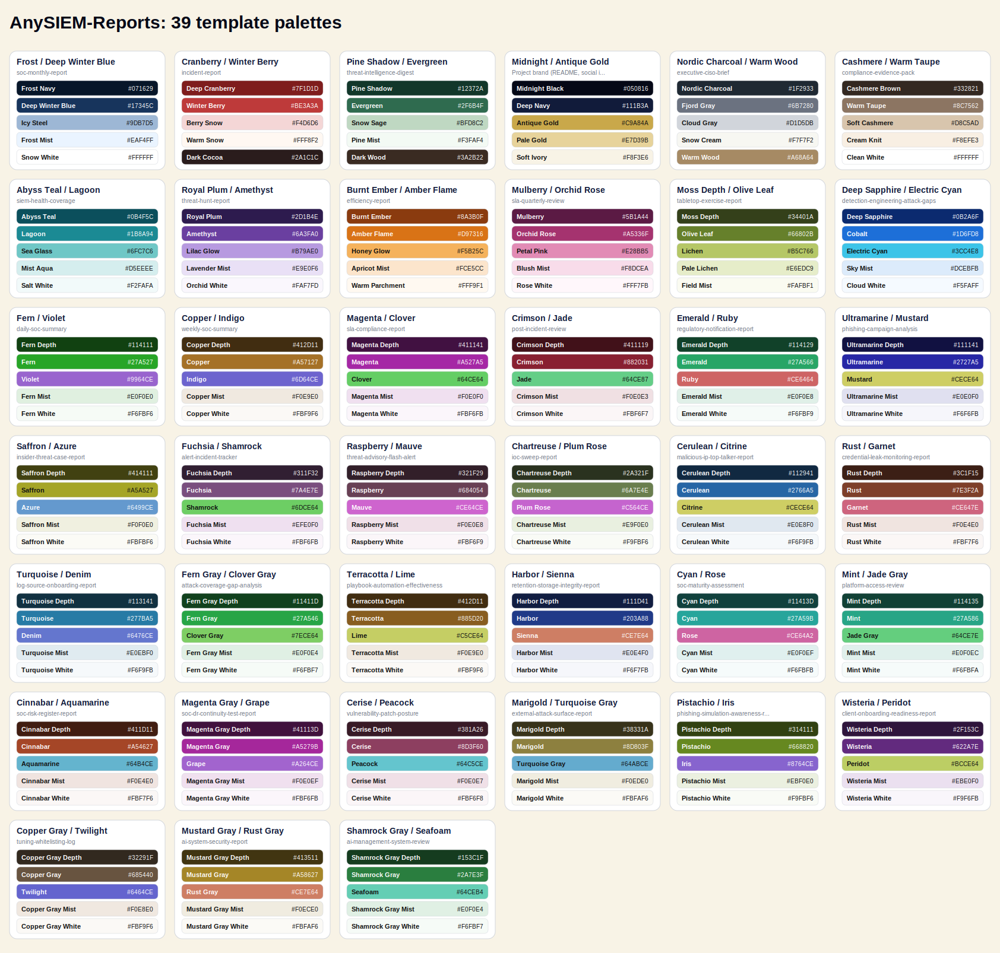

# Color Palettes

Each template uses its own palette, so no two templates look alike. All 39 palettes below are assigned. When you add a template, design a new palette (a hue and accent not yet used, with strong contrast between the primary color and white text) and record it here.

| Palette ID | Name | Assigned to | Primary | Secondary | Accent | Tint | Surface |
|---|---|---|---|---|---|---|---|
| `deep-winter-blue` | Frost / Deep Winter Blue | `soc-monthly-report` | `#17345C` | `#17345C` | `#9DB7D5` | `#EAF4FF` | `#FFFFFF` |
| `deep-cranberry` | Cranberry / Winter Berry | `incident-report` | `#7F1D1D` | `#BE3A3A` | `#F4D6D6` | `#F4D6D6` | `#FFF8F2` |
| `pine-shadow` | Pine Shadow / Evergreen | `threat-intelligence-digest` | `#12372A` | `#2F6B4F` | `#BFD8C2` | `#BFD8C2` | `#F3FAF4` |
| `midnight-gold` | Midnight / Antique Gold | Project brand (README, social images) | `#111B3A` | `#111B3A` | `#C9A84A` | `#E7D39B` | `#F8F3E6` |
| `nordic-charcoal` | Nordic Charcoal / Warm Wood | `executive-ciso-brief` | `#1F2933` | `#6B7280` | `#A68A64` | `#D1D5DB` | `#F7F7F2` |
| `cashmere-brown` | Cashmere / Warm Taupe | `compliance-evidence-pack` | `#332821` | `#8C7562` | `#D8C5AD` | `#D8C5AD` | `#F8EFE3` |
| `deep-teal` | Abyss Teal / Lagoon | `siem-health-coverage` | `#0B4F5C` | `#1B8A94` | `#6FC7C6` | `#D5EEEE` | `#F2FAFA` |
| `royal-plum` | Royal Plum / Amethyst | `threat-hunt-report` | `#2D1B4E` | `#6A3FA0` | `#B79AE0` | `#E9E0F6` | `#FAF7FD` |
| `ember-amber` | Burnt Ember / Amber Flame | `efficiency-report` | `#8A3B0F` | `#D97316` | `#F5B25C` | `#FCE5CC` | `#FFF9F1` |
| `rose-orchid` | Mulberry / Orchid Rose | `sla-quarterly-review` | `#5B1A44` | `#A5336F` | `#E28BB5` | `#F8DCEA` | `#FFF7FB` |
| `olive-moss` | Moss Depth / Olive Leaf | `tabletop-exercise-report` | `#34401A` | `#66802B` | `#B5C766` | `#E6EDC9` | `#FAFBF1` |
| `sapphire-cyan` | Deep Sapphire / Electric Cyan | `detection-engineering-attack-gaps` | `#0B2A6F` | `#1D6FD8` | `#3CC4E8` | `#DCEBFB` | `#F5FAFF` |
| `fern-violet` | Fern / Violet | `daily-soc-summary` | `#114111` | `#27A527` | `#9964CE` | `#E0F0E0` | `#F6FBF6` |
| `copper-indigo` | Copper / Indigo | `weekly-soc-summary` | `#412D11` | `#A57127` | `#6D64CE` | `#F0E9E0` | `#FBF9F6` |
| `magenta-clover` | Magenta / Clover | `sla-compliance-report` | `#411141` | `#A527A5` | `#64CE64` | `#F0E0F0` | `#FBF6FB` |
| `crimson-jade` | Crimson / Jade | `post-incident-review` | `#411119` | `#882031` | `#64CE87` | `#F0E0E3` | `#FBF6F7` |
| `emerald-ruby` | Emerald / Ruby | `regulatory-notification-report` | `#114129` | `#27A566` | `#CE6464` | `#E0F0E8` | `#F6FBF9` |
| `ultramarine-mustard` | Ultramarine / Mustard | `phishing-campaign-analysis` | `#111141` | `#2727A5` | `#CECE64` | `#E0E0F0` | `#F6F6FB` |
| `saffron-azure` | Saffron / Azure | `insider-threat-case-report` | `#414111` | `#A5A527` | `#6499CE` | `#F0F0E0` | `#FBFBF6` |
| `fuchsia-shamrock` | Fuchsia / Shamrock | `alert-incident-tracker` | `#311F32` | `#7A4E7E` | `#6DCE64` | `#EFE0F0` | `#FBF6FB` |
| `raspberry-mauve` | Raspberry / Mauve | `threat-advisory-flash-alert` | `#321F29` | `#684054` | `#CE64CE` | `#F0E0E8` | `#FBF6F9` |
| `chartreuse-plum-rose` | Chartreuse / Plum Rose | `ioc-sweep-report` | `#2A321F` | `#6A7E4E` | `#C564CE` | `#E9F0E0` | `#F9FBF6` |
| `cerulean-citrine` | Cerulean / Citrine | `malicious-ip-top-talker-report` | `#112941` | `#2766A5` | `#CECE64` | `#E0E8F0` | `#F6F9FB` |
| `rust-garnet` | Rust / Garnet | `credential-leak-monitoring-report` | `#3C1F15` | `#7E3F2A` | `#CE647E` | `#F0E4E0` | `#FBF7F6` |
| `turquoise-denim` | Turquoise / Denim | `log-source-onboarding-report` | `#113141` | `#277BA5` | `#6476CE` | `#E0EBF0` | `#F6F9FB` |
| `fern-gray-clover-gray` | Fern Gray / Clover Gray | `attack-coverage-gap-analysis` | `#11411D` | `#27A546` | `#7ECE64` | `#E0F0E4` | `#F6FBF7` |
| `terracotta-lime` | Terracotta / Lime | `playbook-automation-effectiveness` | `#412D11` | `#885D20` | `#C5CE64` | `#F0E9E0` | `#FBF9F6` |
| `harbor-sienna` | Harbor / Sienna | `retention-storage-integrity-report` | `#111D41` | `#203A88` | `#CE7E64` | `#E0E4F0` | `#F6F7FB` |
| `cyan-rose` | Cyan / Rose | `soc-maturity-assessment` | `#11413D` | `#27A59B` | `#CE64A2` | `#E0F0EF` | `#F6FBFB` |
| `mint-jade-gray` | Mint / Jade Gray | `platform-access-review` | `#114135` | `#27A586` | `#64CE7E` | `#E0F0EC` | `#F6FBFA` |
| `cinnabar-aquamarine` | Cinnabar / Aquamarine | `soc-risk-register-report` | `#411D11` | `#A54627` | `#64B4CE` | `#F0E4E0` | `#FBF7F6` |
| `magenta-gray-grape` | Magenta Gray / Grape | `soc-dr-continuity-test-report` | `#41113D` | `#A5279B` | `#A264CE` | `#F0E0EF` | `#FBF6FB` |
| `cerise-peacock` | Cerise / Peacock | `vulnerability-patch-posture` | `#381A26` | `#8D3F60` | `#64C5CE` | `#F0E0E7` | `#FBF6F8` |
| `marigold-turquoise-gray` | Marigold / Turquoise Gray | `external-attack-surface-report` | `#38331A` | `#8D803F` | `#64ABCE` | `#F0EDE0` | `#FBFAF6` |
| `pistachio-iris` | Pistachio / Iris | `phishing-simulation-awareness-report` | `#314111` | `#668820` | `#8764CE` | `#EBF0E0` | `#F9FBF6` |
| `wisteria-peridot` | Wisteria / Peridot | `client-onboarding-readiness-report` | `#2F153C` | `#622A7E` | `#BCCE64` | `#EBE0F0` | `#F9F6FB` |
| `copper-gray-twilight` | Copper Gray / Twilight | `tuning-whitelisting-log` | `#32291F` | `#685440` | `#6464CE` | `#F0E8E0` | `#FBF9F6` |
| `mustard-gray-rust-gray` | Mustard Gray / Rust Gray | `ai-system-security-report` | `#413511` | `#A58627` | `#CE7E64` | `#F0ECE0` | `#FBFAF6` |
| `shamrock-gray-seafoam` | Shamrock Gray / Seafoam | `ai-management-system-review` | `#153C1F` | `#2A7E3F` | `#64CEB4` | `#E0F0E4` | `#F6FBF7` |
